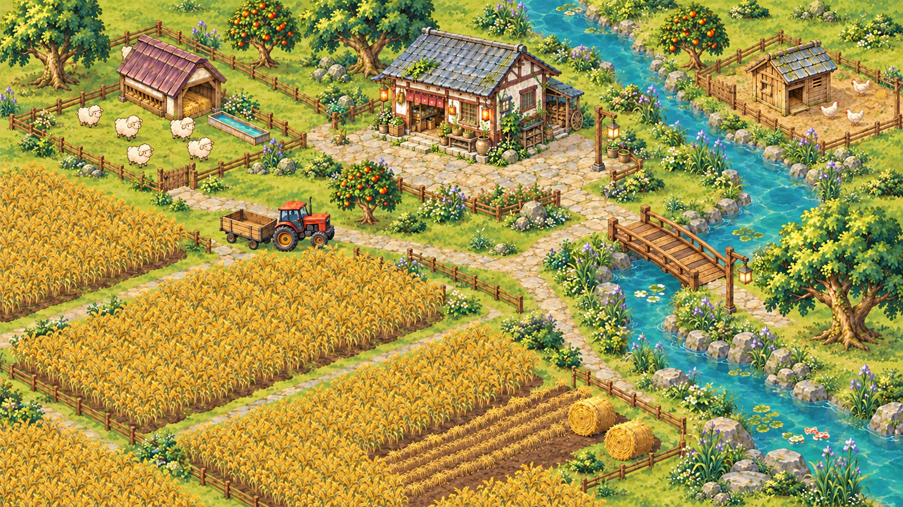
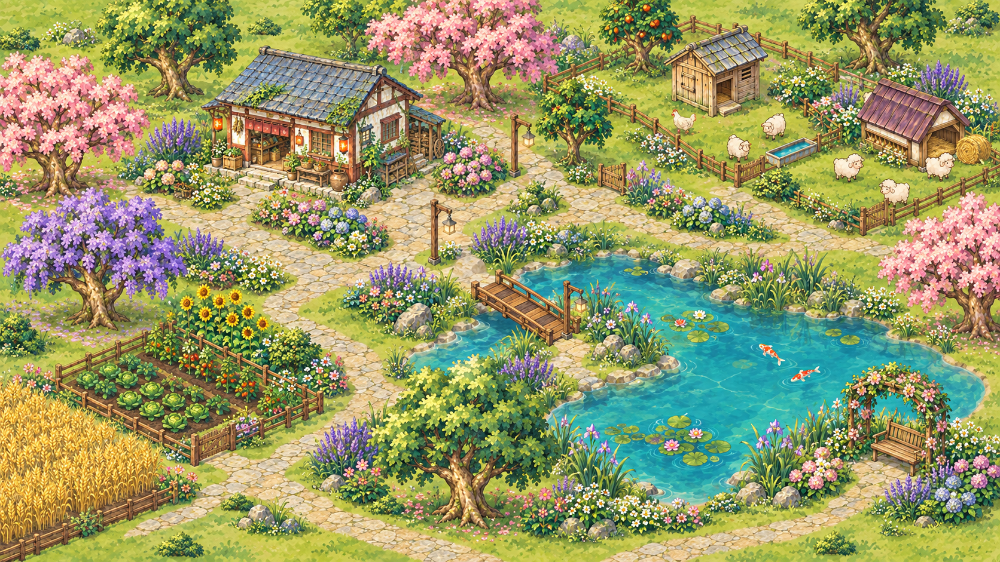
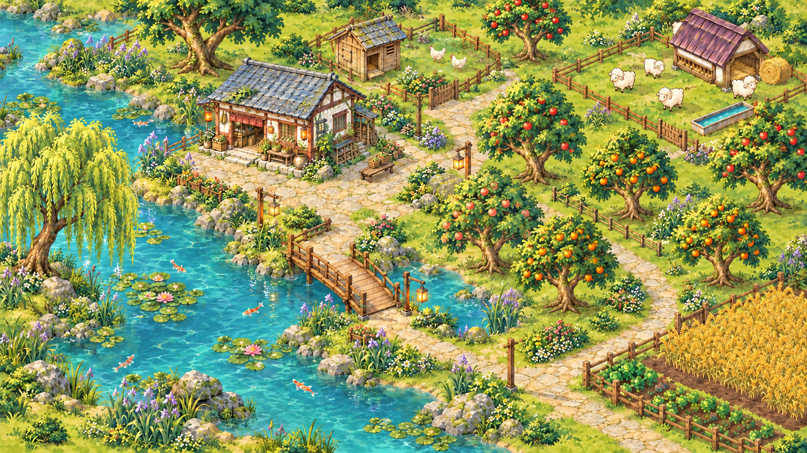

# 桌面农场 · 溪畔双院

把一座可以种地、养鸡养羊、喂鱼和自由布置的小农场搬到 Mac 桌面上。

*封面：图 1「麦田牧歌」，以现有素材为参考绘制的布局示意，并非实机截图。*

**Mac 公开试玩版 · 0.23.1-preview.2**，游戏界面为中文。本仓库用于成品下载、说明和问题反馈，源代码不公开。

[下载 Mac 试玩包](https://github.com/janiezhang52-lab/desktop-farm/releases/download/v0.23.1-preview.2/DesktopFarm-TwinCourts-0.23.1-preview.2-macOS26-arm64.zip) · [版本说明与校验文件](https://github.com/janiezhang52-lab/desktop-farm/releases/tag/v0.23.1-preview.2) · [反馈问题](https://github.com/janiezhang52-lab/desktop-farm/issues)

小屋放在哪里、菜地开多大、小路怎么绕、池塘挖成什么形状，都可以自己决定。你可以种出大片麦田，也可以搭一座开满花、能看鱼的小院。

## 你的农场，可以这样布置

以下三张是**以本项目现有素材为参考、由 AI 辅助绘制的布局灵感图**，用于参考景观搭配；并非游戏截图或可直接导入的场景，具体造型与摆放以游戏为准。当前试玩包附带的初始场景仍是「溪畔双院」。

### 麦田牧歌

让大片金色麦田成为主景，把商店和牧场放在后侧，沿溪流留一条通往木桥的小路。

[查看「麦田牧歌」大图](preview.png)

搭配思路：先确定麦田与水的位置，用田埂分开几块大田；树只在边角点缀，让麦穗、小羊和小屋都看得清楚。

### 花溪小院

小屋前留出石板院子，用高低不同的花、几株彩树和一片自由形状的鱼塘，搭出自己的花园。

搭配思路：花成片种在路径和水边，给道路留出空隙；用长椅、花架和灯饰做一个能停下来赏景的小角落。

### 果园水岸

让水绕着小院延伸，一侧种果树，一侧留给小动物，再沿路安排几块菜地和麦田。

搭配思路：果树错落摆放，中间留出草地与小路；先确定桥两端的落点，再布置岸石、芦苇和荷花。

## 现在可以玩些什么

- **自由布置**：开田、铺路、摆围栏、小屋、树木和各种装饰；支持移动、转向、收纳与撤销，还能编辑自己的农场名字牌。
- **种菜与花果**：种胡萝卜、番茄、玉米和小麦，浇水、施肥、收获；种花、栽苹果树、橘子树和桃树。
- **养鸡养羊**：为动物建小屋和院子、取名字、喂食、收蛋、剪毛；小羊偶尔会溜出去偷吃作物，可以点它赶回。
- **挖塘喂鱼**：用笔刷设计池塘、修岸，挑选不同小鱼，撒鱼食看它们围过来。
- **商店与背包**：出售收获换游戏金币，购买种子、物资和小动物，逐渐丰富自己的农场。
- **昼夜变化**：跟随电脑时间，或手动切换晨光、白天、黄昏和夜晚；晨雾可以开关，路灯可以点亮。

平时照常使用桌面文件，想玩就点「玩农场」，按 Esc 回到桌面。进度自动保存，已开始生长的作物在关闭应用后也会继续计时，成熟后等你回来收。

## 下载前确认

| 项目 | 当前试玩版支持范围 |
| --- | --- |
| 电脑 | Apple Silicon Mac，M 系列芯片 |
| 系统 | macOS 26.0 或更新版本 |
| Windows / Intel Mac / 手机 | 本包不支持 |
| 开发工具 | 不需要安装 |
| Apple 签名与公证 | 本地 ad-hoc 签名，未做 Developer ID 签名或公证 |
| 已验证范围 | 本机 macOS 26.5.1 的游戏；打包解压完整性。其他机器下载后的安装待测试 |

下载文件名：`DesktopFarm-TwinCourts-0.23.1-preview.2-macOS26-arm64.zip`，约 135.5 MB。下载后可用同一 Release 的 `SHA256SUMS.txt` 核对文件。

由于尚未经过 Apple 公证，macOS 可能阻止打开下载的应用。请先确认可信来源与校验值，再参考 [Apple 官方说明](https://support.apple.com/zh-cn/102445) 决定是否允许这个应用运行。本包不提供关闭系统保护的脚本。

## 安装与游玩

1. 解压 ZIP，将「溪畔双院.app」拖到「应用程序」。如果已有其他农场在运行，先从菜单退出。
2. 打开应用。平时桌面文件可正常点击；工具条点「玩农场」开始互动，Esc 回到桌面。
3. 点击小屋、溪水、成熟小麦和名字牌使用对应功能。「布置」可以调整道路、田地、围栏和各种摆件；「时光」可以跟随电脑或自己选时间。

修改自动保存，⌘Z 撤销。旧存档不会被初始模板覆盖。程序暂不包含自动更新器。

## 作者与使用范围

由 **Ningning** 发起并主导，与 **Codex（AI 协作者）** 协作完成。

Copyright © 2026 Ningning.

使用范围：允许个人安装游玩，分享官方下载链接，发布正常游玩的截图、视频和直播，包括平台允许的内容创作变现；未经书面许可，不授权转售软件副本、收费分发、改包冒名或篡改作者标识后发布。法定例外不受限制。详细范围见 [使用说明](LICENSE.txt)。

美术包含 AI 辅助生成内容，保留制作来源记录。署名、哈希和发布记录用于来源核对，不是版权认证或防复制保证。
